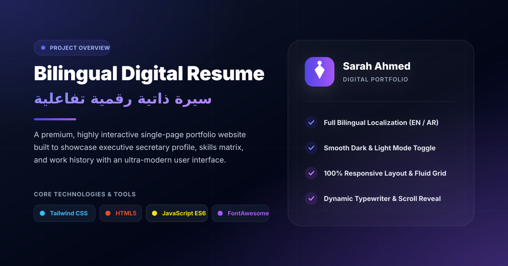

# Interactive Bilingual Digital Resume & Portfolio



An ultra-modern, highly interactive single-page portfolio website designed to showcase the professional profile, core competencies, and extensive work history of an Executive Secretary. This project delivers a premium user experience with fluid animations, dual-language localization, and full responsive behavior.

---

## 🚀 Key Features

- **Full Bilingual Localization:** Seamless instantly switching between English (LTR) and Arabic (RTL) maintaining strict layout alignment.
- **Dynamic Typewriter Effect:** An asynchronous vanilla JavaScript typewriter component that loops through key professional titles smoothly.
- **Scroll-Driven Reveal Animations:** Utilizing the native `Intersection Observer API` to fade and slide sections into view dynamically as the user scrolls.
- **Staggered Skill Progress Bars:** Skill percentage bars animate sequentially with an internal staggered time delay upon entering the viewport.
- **Smart Dark/Light Mode:** Full integration with Tailwind CSS dark class strategy, persistent via `localStorage` and respecting system preferences.
- **Responsive Layout:** A fluid grid structure optimized for all screens ranging from mobile devices to ultra-wide desktop monitors.

---

## 🛠️ Core Tech Stack

- **HTML5:** Semantic architecture to ensure accessibility and high SEO performance.
- **Tailwind CSS:** Modern utility-first framework handling fluid layouts and theme management.
- **Vanilla JavaScript (ES6+):** Pure, lightweight script handling smooth localization, asynchronous animation triggers, and system events without external heavy overhead libraries.
- **FontAwesome v6:** Crisp vector icons serving both linguistic layouts flawlessly.

---

## 📂 Project Structure

```text
├── index.html                 # Main markup file containing template & core JavaScript logic
├── sarah-portfolio-cover.svg   # High-fidelity project showcase & open-graph cover image
└── README.md                  # Comprehensive project documentation

```
## ⚙️ How It Works (Deep Dive)
### 1. Directional Fluidity (LTR ⇄ RTL)
When toggling languages, the script changes the lang and dir attributes on the <html> node. Tailwind CSS automatically handles alignment reversals using directional spacing prefixes like space-x-reverse, right-0, or dynamic directional padding classes.
### 2. Micro-Animations
```javascript
// A brief insight into the Intersection Observer trigger used for skill bars
const observer = new IntersectionObserver((entries) => {
  entries.forEach(entry => {
    if (entry.isIntersecting) {
      entry.target.classList.add('revealed');
      // Triggers the inner staggered CSS variables for skill fills
    }
  });
}, options);

```
## 💻 Installation & Local Setup
Since this web application is built entirely with pure frontend vanilla technologies, it does not require any build tools or complex command-line configurations.
 1. **Clone the repository:**
   ```bash
   git clone [https://github.com/amr-mukardi/sarah-portfolio.git](https://github.com/amr-mukardi/sarah-portfolio.git)
   
  
👨‍💻 Designed & Developed by

Amr AL-Mukardi
Full-Stack Developer | UI/UX Enthusiast

GitHub: @amr-mukardi

---

📄 License

This project is available for educational and portfolio purposes. – feel free to use it as a template, but please give credit.

---

♥

---
⭐ If you like this project, give it a star on GitHub!
